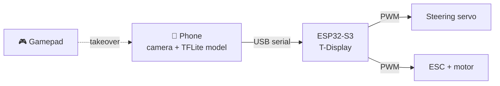

# Smartphone-Driven Autonomous RC Car

Imitation learning on a low-cost Ackermann platform

<div class="mt-12 opacity-70">
Tran Cao Bao An · Supervisor: TODO · 2027
</div>

<!--
Speaker notes go in an HTML comment at the end of a slide.
Press "P" or open /presenter to see them with a timer and the next slide.
-->

---

# Why a smartphone?

<v-clicks>

- Camera, IMU and a fast processor already in your pocket
- A full self-driving sensor kit costs far more than the car
- Goal: **drive a real RC car end-to-end from camera images**

</v-clicks>

<!--
Each bullet appears on click (v-clicks).
-->

---

# System overview



<!--
Diagram is drawn by Mermaid from text, no image editor needed.
-->

---
layout: image-right
image: /rc-truck-banner.jpg
---

# Hardware

- RC car with Ackermann steering
- LilyGO T-Display-S3 drives servo and ESC
- Screen doubles as turn signals and reverse light
- Phone mounted on top, linked over USB

---
layout: center
---

# Demo: autopilot

<video src="/demo_autopilot.mp4" autoplay loop muted controls class="h-80 rounded-lg shadow-xl mx-auto" />

<div class="caption">Placeholder clip. Drop your own .mp4 into public/</div>

---

# Same thing as a GIF

<div class="grid grid-cols-2 gap-8 items-center">
<div>

- GIFs work too, just like images
- But MP4 is usually **smaller and smoother**
- This GIF: 2.2 MB, the MP4 on the last slide: 1.2 MB

</div>

</div>

---

# Turn-weighted loss

Rare sharp turns shouldn't be drowned out by straight driving:

$$
\mathcal{L} = w^2\left(\Delta t^2 + 5\,\Delta s^2\right), \qquad w = 2|s| + 0.05
$$

<v-click>

- $w$ grows with turn sharpness → turns count more
- Steering errors cost **5×** throttle errors

</v-click>

---

# Serial protocol

```cpp {1|2|3|all}
h500        // heartbeat: stop if silent for 500 ms
i0,0        // indicators off
c-40,120    // steer slightly left, drive forward
```

Lines highlight one by one as you click.

---

# Results

| Model | Val. MAE | Laps w/o help | Interventions |
|---|:-:|:-:|:-:|
| PilotNet | — | — | — |
| Memory pilot | — | — | — |

<div class="caption">Fill in from policy/EXPERIMENTS.md</div>

---
layout: end
---

# Thank you

Questions?
